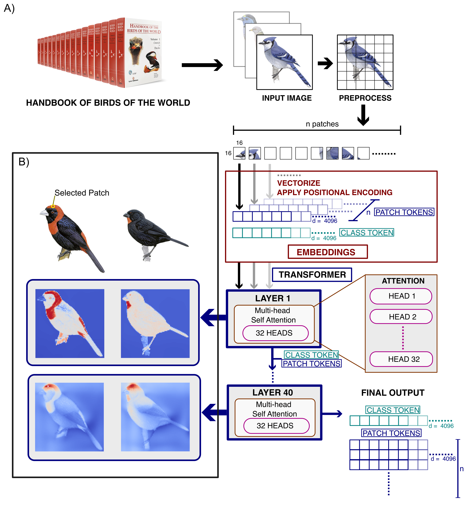

```{r setup, include=FALSE}
knitr::opts_chunk$set(echo = TRUE)
knitr::opts_chunk$set(eval = FALSE)
knitr::opts_chunk$set(python.reticulate = FALSE)
knitr::opts_knit$set(root.dir = 'files')
```

This markdown files has the codes for the Avian AI paper. 

```{r echo=FALSE, eval=TRUE, warning=FALSE, message=FALSE}
library(ggplot2)
library(ggrepel)
library(arrow)
library(pracma)
library(LPCM)
library(coop)
library(tidyverse)
library(dplyr)
library(ape)
library(phytools)
library(ggtree)
library(ggtreeExtra)
library(reticulate)
library(vegan)
library(pheatmap)
library(cowplot)
```

```{r echo=FALSE, eval=TRUE, warning=FALSE, message=FALSE}
euclidean_distance <- function(a, b) {
  sqrt(sum((a - b)^2))
}

cosine_distance <- function(a, b) {
  1 - sum(a * b) / (sqrt(sum(a^2)) * sqrt(sum(b^2)))
}
```


The dataset comprises 13,309 images of male birds from [Birds of the World](https://birdsoftheworld.org/bow/home).

# Overview
The general outline of the DINOv3 [@dinov3_2025] is show in the following schematic:



# Phenotypic Variation
We embedded all images using DINOv3. Then we used t-SNE to visualize the dispersal of taxa in 2D space.

```{r eval=TRUE, echo=TRUE, warning=FALSE, message=FALSE}
embeddings <- read_parquet("embeddings_dinov3_vit7b_2d_wo_embedding.parquet")

cols <- rep("gray80", nrow(embeddings))
cols[which(embeddings$Family == "Haematopodidae")] <- "#1065AB"
cols[which(embeddings$Family == "Vangidae")] <- "#B31529"
cols[which(embeddings$Family == "Columbidae")] <- "#D1E5F0"
cols[which(embeddings$Family == "Thraupidae")] <- "#FEDBC7"

alpha_vals <- ifelse(cols == "gray80", 0.5, 1)   
size_vals  <- ifelse(cols == "gray80", 2, 3)  

gray_idx    <- which(cols == "gray80")
colored_idx <- which(cols != "gray80")

ggplot() +
  # gray background points
  geom_point(
    data = embeddings[gray_idx, ],
    aes(x = x, y = y),
    pch = 21,
    color = "gray30",
    fill = "gray80",
    size = 2,
    alpha = 0.5
  ) +
  # colored points on top
  geom_point(
    data = embeddings[colored_idx, ],
    aes(x = x, y = y, fill = Family),
    pch = 21,
    color = "gray30",
    size = 3,
    alpha = 1
  ) +
  scale_fill_manual(values = c(
    "Haematopodidae" = "#1065AB",
    "Vangidae"      = "#B31529",
    "Columbidae"     = "#D1E5F0",
    "Thraupidae"     = "#FEDBC7"
  )) +
  theme_bw()+
  labs(y = "tsne-y", x="tsne-x")
```

The different families of birds have different distributions. We visualized the distribution of different families (with more than 10 species) by estimating their silhoutte scores.

```{r eval=TRUE, echo=TRUE, warning=FALSE, message=FALSE, fig.height=14, fig.width=7}
clusters <- read.table("family_silhouette_scores_min10_cosine.csv", sep = ",", header = T)
clusters <- clusters[order(-clusters$silhouette_mean),]

cols <- rep("gray80", nrow(clusters))
cols[1] <- "#1065AB"
cols[nrow(clusters)] <- "#B31529"
cols[which(clusters$Family == "Columbidae")] <- "#D1E5F0"
cols[which(clusters$Family == "Thraupidae")] <- "#FEDBC7"

ggplot(clusters, aes(y = reorder(Family, silhouette_mean), x = silhouette_mean)) +
  geom_bar(stat = "identity", fill =  cols, col="gray") +
  geom_point(aes(size = n), color = "red", shape = 21, fill = "white") +
  theme_bw() +
  #theme(axis.text.x = element_text(angle = 90, vjust = 0.5, hjust=1)) +
  labs(y = "Family", x="Silhouette Score")
```

Next we took two families, one clustered (Columbidae) and one dispersed (Thraupidae) to understand if clustering patterns seen at family level is seen at lower  taxonomic levels.

## Columbidae

```{r eval=TRUE, echo=TRUE, warning=FALSE, message=FALSE}
embeddings_all <- read_parquet("embeddings_dinov3_vit7b_2d_with_cls_embedding_.parquet")
embeddings_col <- subset(embeddings_all, Family %in% "Columbidae")

columbidae <- as.data.frame(subset(embeddings, Family %in% "Columbidae"))
columbi_genera <- read.table("columbid_genera.txt", header = F, sep = "\t")

columbidae <- columbidae %>%
  mutate(Genus = str_split(`Scientific Name`, " ") %>% sapply(`[`, 1)) %>%
  left_join(
    columbi_genera %>%
      dplyr::rename(Genus = V1,
             Tribe = V2),
    by = c("Genus" = "Genus")
  )

# to calculate mode within columbidae
columb_data <-  do.call(rbind, embeddings_col$embedding)
pca_columb <- prcomp(columb_data, center = TRUE, scale. = TRUE, rank. = 10)
var_explained <- (pca_columb$sdev)^2
prop_var_explained <- var_explained / sum(var_explained)
cum_var_explained <- cumsum(prop_var_explained)

# using different values of h to get at the different clustering strategies
# n <- 1:10
# for (i in n){
#   columb_result <- LPCM::ms(pca_columb$x, h = i/10, plot = FALSE)
#   print(paste("For n =", i/10, ":", length(unique(columb_result$cluster.label))))
# }

# For 7 groups
columb_result <- LPCM::ms(pca_columb$x, h = 0.2, plot = FALSE)

# get mode for largest group
mode_center <- columb_result$cluster.center[1, ]

columbidae$cluster <- columb_result$cluster.label

ggplot(columbidae, aes(x = x, y = y)) +
  geom_point(
    aes(colour = factor(cluster)),
    alpha = 0.3
  ) +
  stat_density_2d(
    aes(x = x, y = y),
    geom = "contour",
    bins = 15,
    colour = "black"
  ) +
  theme_classic() +
  labs(colour = "Cluster")

distances <- apply(columb_result$data, 1, function(point) euclidean_distance(point, mode_center))
columbidae$euc_dist <- distances

# get modal species by finding the closest species to the mode_center
mode_species <- columbidae$`Scientific Name`[which.min(columbidae$euc_dist)]
mode_embeddings <- embeddings_col$embedding[which(embeddings_col$`Scientific Name` %in% mode_species)]

# calculate cosine distance from modal species to all other species
distances_cos <- sapply(embeddings_col$embedding, function(point) {
  cosine_distance(unlist(point), unlist(mode_embeddings))
})
columbidae$cos_dist <- distances_cos

columbidae$cos_dist_norm <- (
  (columbidae$cos_dist - min(columbidae$cos_dist)) /
    (max(columbidae$cos_dist) - min(columbidae$cos_dist))
) * 100

columbidae <- columbidae[order(columbidae$cos_dist_norm),]
columbidae$order <- 1:nrow(columbidae)

columbidae$pt_size <- 2
columbidae$pt_size[c(1,2,4,5,10,20,30,40,50,75,100,150,200,250,300,325,nrow(columbidae))] <- 4
```


```{r eval=TRUE, echo=TRUE, warning=FALSE, message=FALSE}
ggplot(columbidae, aes(x = x, y = y)) +
  geom_point(aes(color = Tribe, size = 2, alpha = 0.8)) +
  theme_minimal(base_size = 14) +
  theme(
    panel.grid.major = element_line(color = "grey85", linewidth = 0.5),
    panel.grid.minor = element_line(color = "grey90", linewidth = 0.3),
    panel.background = element_rect(fill = "white", color = NA),
    panel.border = element_rect(color = "black", fill = NA, linewidth = 1)
  ) +
  geom_text_repel(
    data = subset(columbidae, pt_size == 4),
    aes(x = x, y = y, label=order),
    nudge_y = 0.5,        
    min.segment.length = 0,
    max.overlaps = Inf,
    size = 3
  ) +
  scale_color_manual(values= c("#eccbae", "#046c9a", "#6d8474", "#d69c4e", "#c0bc96", "#abddde", "#556e65", "#000000")) +
  scale_size_identity()+
  labs(y = "tsne-y", x="tsne-x")
```

```{r, eval=TRUE, echo=TRUE, warning=FALSE, message=FALSE, fig.width=15, fig.height=5}
ggplot(columbidae, aes(x = cos_dist_norm, y = 0)) +
  geom_segment(
    aes(x = 0, y = 0, xend = 100, yend = 0),
    inherit.aes = FALSE,
    color = "black",
    linewidth = 1
  ) +
  geom_point(
    aes(color = Tribe, size = pt_size),
    shape = 16,
    stroke = 1
  ) +
  geom_text_repel(
    data = subset(columbidae, pt_size == 4),
    aes(label = order, y = 0),
    nudge_y = 0.05,        
    direction = "y",       
    min.segment.length = 0,
    size = 3
  ) +
  scale_size_identity() +
  coord_cartesian(ylim = c(-0.01, 0.05), expand = FALSE)+
  scale_color_manual(values= c("#eccbae", "#046c9a", "#6d8474", "#d69c4e", "#c0bc96", "#abddde", "#556e65", "#000000")) +
  theme_minimal(base_size = 14) +
  labs(y = "Position", x="Cosine Distance") +
  theme(
    axis.ticks.y = element_blank(),
    axis.line.y  = element_blank(),
    axis.title.y = element_blank(),
    axis.text.y  = element_blank()
  )
```

```{r, eval=TRUE, echo=FALSE, warning=FALSE, message=FALSE, fig.width=15, fig.height=3}
ggplot(columbidae, aes(x = cos_dist_norm)) +
  geom_histogram(
    bins = 20,
    boundary = 0,
    color = "black",
    fill = "grey80"
  ) +
  scale_x_continuous(
    limits = c(0, 100),
    breaks = seq(0, 100, 10),
    expand = c(0, 0)
  ) +
  labs(
    x = "Cosine distance (normalized)",
    y = "Count"
  ) +
  theme_minimal(base_size = 14)
```

## Thraupidae

```{r eval=TRUE, echo=TRUE, warning=FALSE, message=FALSE}
embeddings_thr <- subset(embeddings_all, Family %in% "Thraupidae")

thraupidae <- as.data.frame(subset(embeddings, Family %in% "Thraupidae"))
thraupid_genera <- read.table("thraupid_genera.txt", header = F, sep = "\t")

thraupidae <- thraupidae %>%
  mutate(Genus = str_split(`Scientific Name`, " ") %>% sapply(`[`, 1)) %>%
  left_join(
    thraupid_genera %>%
      dplyr::rename(Genus = V1,
                    Subfamily = V2),
    by = c("Genus" = "Genus")
  )

# to calculate mode within columbidae
thraup_data <-  do.call(rbind, embeddings_thr$embedding)
pca_thraup <- prcomp(thraup_data, center = TRUE, scale. = TRUE, rank. = 10)
var_explained <- (pca_thraup$sdev)^2
prop_var_explained <- var_explained / sum(var_explained)
cum_var_explained <- cumsum(prop_var_explained)

# n <- 1:10
# for (i in n){
#   thraup_result <- LPCM::ms(pca_thraup$x, h = i/10, plot = FALSE)
#   print(paste("For n =", i/10, ":", length(unique(thraup_result$cluster.label))))
# }

# for 10 clusters
thraup_result <- LPCM::ms(pca_thraup$x, h = 0.2, plot = FALSE)
table(thraup_result$cluster.label)

# get mode for largest group
mode_center <- thraup_result$cluster.center[1, ]

thraupidae$cluster <- thraup_result$cluster.label

ggplot(thraupidae, aes(x = x, y = y)) +
  geom_point(
    aes(colour = factor(cluster)),
    alpha = 0.3
  ) +
  stat_density_2d(
    aes(x = x, y = y),
    geom = "contour",
    bins = 15,
    colour = "black"
  ) +
  theme_classic() +
  labs(colour = "Cluster")

distances <- apply(thraup_result$data, 1, function(point) euclidean_distance(point, mode_center))
thraupidae$euc_dist <- distances

# get modal species by finding the closest species to the mode_center
mode_species <- thraupidae$`Scientific Name`[which.min(thraupidae$euc_dist)]
mode_embeddings <- embeddings_thr$embedding[which(embeddings_thr$`Scientific Name` %in% mode_species)]

# calculate cosine distance from modal species to all other species
distances_cos <- sapply(embeddings_thr$embedding, function(point) {
  cosine_distance(unlist(point), unlist(mode_embeddings))
})
thraupidae$cos_dist <- distances_cos

thraupidae$cos_dist_norm <- (
  (thraupidae$cos_dist - min(thraupidae$cos_dist)) /
    (max(thraupidae$cos_dist) - min(thraupidae$cos_dist))
) * 100

thraupidae <- thraupidae[order(thraupidae$cos_dist_norm),]
thraupidae$order <- 1:nrow(thraupidae)

thraupidae$pt_size <- 2
thraupidae$pt_size[c(1,2,4,5,10,15,20,25,50,75,100,125,150,175,200,250,300,400,500,nrow(thraupidae))] <- 4
```


```{r eval=TRUE, echo=TRUE, warning=FALSE, message=FALSE}
ggplot(thraupidae, aes(x = x, y = y)) +
  geom_point(aes(color = Subfamily, size = 2, alpha = 0.8)) +
  theme_minimal(base_size = 14) +
  theme(
    panel.grid.major = element_line(color = "grey85", linewidth = 0.5),
    panel.grid.minor = element_line(color = "grey90", linewidth = 0.3),
    panel.background = element_rect(fill = "white", color = NA),
    panel.border = element_rect(color = "black", fill = NA, linewidth = 1)
  ) +
  geom_text_repel(
    data = subset(thraupidae, pt_size == 4),
    aes(x = x, y = y, label=order),
    nudge_y = 0.5,
    min.segment.length = 0,
    max.overlaps = Inf,
    size = 3
  ) +
  scale_color_manual(values= c("#eccbae", "#a9a4a8", "#6794a2ff", "#25799cff", "#21728fff", "#5d8079ff", "#998e63ff", "#d69c4eff", "#c9ae77ff",
                               "#bdc1a0ff", "#b1d3c9ff", "#92bdbeff", "#617e7eff", "#303f3fff", "black")) +
  scale_size_identity()+
  labs(y = "tsne-y", x="tsne-x")
```

```{r, eval=TRUE, echo=TRUE, warning=FALSE, message=FALSE, fig.width=15, fig.height=5}
ggplot(thraupidae, aes(x = cos_dist_norm, y = 0)) +
  geom_segment(
    aes(x = 0, y = 0, xend = 100, yend = 0),
    inherit.aes = FALSE,
    color = "black",
    linewidth = 1
  ) +
  geom_point(
    aes(color = Subfamily, size = pt_size),
    shape = 16,
    stroke = 1
  ) +
  geom_text_repel(
    data = subset(thraupidae, pt_size == 4),
    aes(label = order, y = 0),
    nudge_y = 0.05,        
    direction = "y",       
    min.segment.length = 0,
    size = 3
  ) +
  scale_size_identity() +
  coord_cartesian(ylim = c(-0.01, 0.05), expand = FALSE)+
  scale_color_manual(values= c("#eccbae", "#a9a4a8", "#6794a2ff", "#25799cff", "#21728fff", "#5d8079ff", "#998e63ff", "#d69c4eff", "#c9ae77ff",
                               "#bdc1a0ff", "#b1d3c9ff", "#92bdbeff", "#617e7eff", "#303f3fff", "black")) +
  theme_minimal(base_size = 14) +
  labs(y = "Position", x="Cosine Distance") +
  theme(
    axis.ticks.y = element_blank(),
    axis.line.y  = element_blank(),
    axis.title.y = element_blank(),
    axis.text.y  = element_blank()
  )
```

```{r, eval=TRUE, echo=FALSE, warning=FALSE, message=FALSE, fig.width=15, fig.height=3}
ggplot(thraupidae, aes(x = cos_dist_norm)) +
  geom_histogram(
    bins = 20,
    boundary = 0,
    color = "black",
    fill = "grey80"
  ) +
  scale_x_continuous(
    limits = c(0, 100),
    breaks = seq(0, 100, 10),
    expand = c(0, 0)
  ) +
  labs(
    x = "Cosine distance (normalized)",
    y = "Count"
  ) +
  theme_minimal(base_size = 14)
```

# Genotype-Phenotype
## Mantel test
We tested whether phenotypic distance (from embeddings) and genotypic distance (from @mctavish_complete_2025) were correlated with one another. To do this we used a Mantel test

```{r eval=TRUE, echo=TRUE, warning=FALSE, message=FALSE, fig.height=6.5, fig.width=5}
mantel_data <- read.csv("family_mantel_results.csv")
mantel_data <- mantel_data[order(mantel_data$Mantel_r),]
mantel_data$Family <- factor(mantel_data$Family, levels = mantel_data$Family)
ggplot(mantel_data, aes(x=Mantel_r, y=Family, fill=significant))+
  geom_point(aes(size = n), pch=21) +
  theme_classic() +
  scale_fill_manual(values = c("gray", "orange"))
```

## Woodpeckers
We use the woodpeckers to showcase how the genetic distance and phenotypic disance can be used to estimate convergence and divergence.

```{r eval=TRUE, echo=TRUE, warning=FALSE, message=FALSE, fig.height=9, fig.width=10}
tree <- read.tree("phylo_only_clements_labels_ultrametric.tre") #Clements tree from clootl
tree <- keep.tip(tree, gsub(" ", "_", embeddings_all$`Parent Species`[which(embeddings_all$Family %in% "Picidae")]))

wood_gen <- as.matrix(read.csv("picidae_gen.csv", row.names = 1,check.names = F)) #genetic data from mctavish et al 2025
wood_mor <- as.matrix(read.csv("picidae_morph.csv", row.names = 1,check.names = F)) #phenotypic data from cosine similarity 

all_sp <- read.table("picidae_list.txt", sep = "_")
all_sp$V1 <- gsub(" ", "_", all_sp$V1)
tree <- rotateConstr(tree, unique(all_sp$V1))

p <- ggtree(tree)
df <- p$data
tip_order <- rev(df$label[df$isTip][order(df$y[df$isTip])])

wood_gen <- wood_gen[tip_order, tip_order]
wood_mor <- wood_mor[tip_order, tip_order]

wood_gen_scaled <- (wood_gen - min(wood_gen)) / (max(wood_gen) - min(wood_gen))
wood_mor_scaled <- (wood_mor - min(wood_mor)) / (max(wood_mor) - min(wood_mor))

plot_mat <- wood_mor_scaled
plot_mat[lower.tri(plot_mat)] <- wood_gen_scaled[lower.tri(wood_gen_scaled)]

tree <- keep.tip(tree, rownames(wood_mor))

ix <- order(wood_mor, na.last = NA)
rc <- arrayInd(ix, dim(wood_mor))

top <- data.frame(
  row   = rownames(wood_mor)[rc[,1]],
  col   = colnames(wood_mor)[rc[,2]],
  value = wood_mor[ix]
)

top_gen <- data.frame(
  row   = rownames(wood_gen)[rc[,1]],
  col   = colnames(wood_gen)[rc[,2]],
  value_gen = wood_gen[ix]
)

top_merged <- merge(top, top_gen, by=c("row", "col"))
model <- lm(top_merged$value ~ top_merged$value_gen)
top_merged$res <- residuals(model)

top_merged <- subset(top_merged, value > 0)
top_merged$genus_row <- str_extract(top_merged$row, "^[^_]+")
top_merged$genus_col <- str_extract(top_merged$col, "^[^_]+")
top_merged$same_genus <- top_merged$genus_row == top_merged$genus_col

top_conv <- subset(top_merged, same_genus == F)
top_conv <- top_conv[order(top_conv$res),]
rownames(top_conv) <- NULL
top_div <- subset(top_merged, same_genus == T)
top_div <- top_div[order(-top_div$res),]
rownames(top_div) <- NULL

labels <- rbind(top_conv[c(1,7,25),], top_div[c(1,5,7),])
labels$index <- 1:nrow(labels)

wood_cos_long <- as.data.frame(plot_mat) %>%
  rownames_to_column("label") %>%
  pivot_longer(
    cols = -label,
    names_to = "feature",
    values_to = "value"
  ) %>%
  mutate(
    label   = factor(label, levels = tip_order),
    feature = factor(feature, levels = tip_order)
  ) %>%
  arrange(label, feature)

p <- ggtree(tree) +
  geom_fruit(
    data = wood_cos_long,
    geom = geom_tile,
    mapping = aes(
      y = label,
      x = feature,
      fill = value
    ),
    pwidth = 12,
    offset = 0.01
  ) +
  scale_fill_viridis_c(direction = -1) +
  labs(x = "Divergence Time (GD)")

top_title <- ggdraw() +
  draw_label(
    "Phenotypic Distance (PD)",
    x = 0.5,
    y = 0.5,
    hjust = 0.5,
    vjust = 0.5,
    size = 11
  )

plot_grid(
  top_title,
  p,
  ncol = 1,
  rel_heights = c(0.02, 1)
)
```

Convergence and divergence can be ascertained by comparing residuals.

```{r eval=TRUE, echo=TRUE, warning=FALSE, message=FALSE, fig.height=5, fig.width=6}
ggplot(top_merged, aes(y = value, x = value_gen, col = res)) +
  geom_point() +
  geom_smooth(
    method = "lm",
    se = FALSE,
    color = "black"
  ) +
  scale_color_gradientn(
    colours = c("orange", "blue")
  ) +
  labs(
    x = "Genetic distance",
    y = "Phenotypic distance"
  ) +
  theme_classic()
```


# References